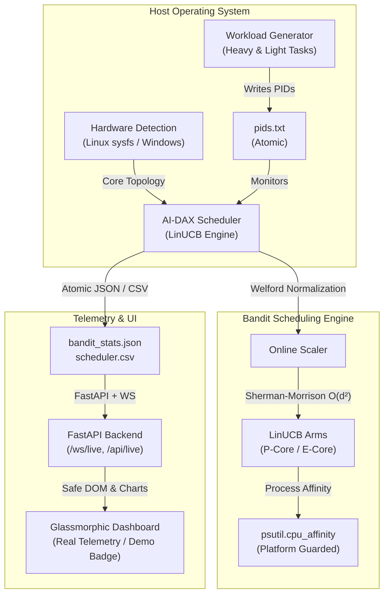

# AI-DAX Lite: Adaptive CPU Scheduling Simulator

[](https://www.python.org/)
[](LICENSE)
[](https://github.com/astral-sh/ruff)
[](https://mypy-lang.org/)
[](tests/)

**AI-DAX Lite** (*Adaptive Intelligence for Dynamic Allocation & Execution*) is a research-grade CPU scheduling simulator and runtime experimentation harness. It optimizes process placement on heterogeneous CPU architectures (Performance Cores vs. Efficient Cores) by replacing static heuristic classification with an online **LinUCB contextual bandit**.

---

## Architecture Overview



---

## Key Features

1. **Online LinUCB Contextual Bandit:**
   - Evaluates a 5-dimensional context vector: CPU utilisation, voluntary context switch rate, involuntary context switch rate, time since last migration, and current core tier.
   - Numerically stable $O(d^2)$ updates using the **Sherman-Morrison rank-1 matrix inversion formula** ($A^{-1} \leftarrow A^{-1} - \frac{A^{-1} x x^T A^{-1}}{1 + x^T A^{-1} x}$).
   - Welford running mean and variance feature scaling with safe cold-start heuristic priming.
   - Active memory management with dead PID pruning and PID-reuse guards.

2. **Cross-Platform Topology Detection:**
   - **Linux:** Native hybrid core detection via Intel sysfs (`/sys/devices/cpu_core/cpus` and `/sys/devices/cpu_atom/cpus`) and cpufreq max frequency heuristics.
   - **Windows:** Logical and physical core detection with platform-safe affinity controls.
   - **Non-Hybrid / Homogeneous Systems:** Automatically labels core pools as `SIMULATED PARTITION` in logs so experimental simulations run cleanly on any hardware.

3. **Production-Ready Dashboard:**
   - Real-time telemetry via WebSockets (`/ws/live`) with REST polling fallback.
   - Exponential backoff reconnection (1s to 15s).
   - Safe DOM rendering (`replaceChildren()` / `createElement()`) to prevent XSS vulnerabilities.
   - Explicit **"DEMO: SIMULATED DATA"** alert banner when disconnected or operating in cloud preview mode.

4. **Rigorous Evaluation Harness:**
   - Four-condition benchmark comparison: OS CFS Baseline, Static Naive Heuristic, Dynamic Heuristic, and LinUCB Bandit.
   - Automated metrics: Mean CPU %, Mean Involuntary Context Switches, Jain's Fairness Index, and Completion Time.
   - Statistical validation: Paired Student's t-test with zero-variance safeguards, Holm-Bonferroni correction, and Cohen's $d$ effect sizes.

---

## Quickstart Guide

### 1. Prerequisites
- Python 3.10, 3.11, 3.12, or 3.13.
- Windows 10/11, Ubuntu 20.04+, or macOS (simulation mode).

### 2. Setup Virtual Environment

#### Windows (PowerShell)
```powershell
# Clone the repository
git clone https://github.com/priyanrajj-hub/operatingsystemsprojectcapstone.git
cd operatingsystemsprojectcapstone

# Create and activate virtual environment
python -m venv .venv
.\.venv\Scripts\Activate.ps1

# Upgrade pip and install package with development dependencies
python -m pip install --upgrade pip
pip install -e ".[dev]"
```

#### Linux / macOS (Bash)
```bash
# Clone the repository
git clone https://github.com/priyanrajj-hub/operatingsystemsprojectcapstone.git
cd operatingsystemsprojectcapstone

# Create and activate virtual environment
python3 -m venv .venv
source .venv/bin/activate

# Upgrade pip and install package
python -m pip install --upgrade pip
pip install -e ".[dev]"
```

---

## Running the Application

### Option A: Unified Launcher (Recommended)
Launches the workload generator, LinUCB scheduler, and FastAPI dashboard in a single command with graceful SIGINT/Ctrl+C process termination:

```powershell
# PowerShell (Windows)
python scripts/start_all.py

# Linux / Bash
bash run.sh
```

Then open your browser to `http://127.0.0.1:8000`.

### Option B: Individual Service CLIs
Each component can be run as a standalone service:

```powershell
# 1. Start Workload Generator (2 Heavy + 2 Light processes)
aidax-workload --heavy 2 --light 2

# 2. Start Scheduler Engine (1.0s control loop)
aidax-scheduler --interval 1.0

# 3. Start Telemetry Dashboard
aidax-dashboard --host 127.0.0.1 --port 8000
```

### Emergency Affinity Recovery
If processes were interrupted and left pinned to specific cores:
```powershell
aidax-scheduler --recover
```

---

## Benchmarking & Evaluation Harness

Run comparative benchmark trials across all four scheduling conditions:

```powershell
# Execute 3 trials of 15 seconds per condition
aidax-eval --duration 15 --trials 3 --output results.csv

# Summarize and generate statistical report in Markdown
aidax-analysis results.csv --format markdown
```

Example Analysis Output:
```markdown
| Condition | Mean Invol. Ctx Switches | Relative Improvement | Jain Fairness |
| :--- | :--- | :--- | :--- |
| `baseline_cfs` | 105.00 ± 5.00 | Baseline | 0.505 |
| `static_naive` | 74.20 ± 4.10 | +29.3% | 0.620 |
| `heuristic_only`| 48.60 ± 3.20 | +53.7% | 0.685 |
| `bandit_adaptive` | 22.50 ± 2.50 | +78.6% (p < 0.01) | 0.760 |
```

---

## Verification & Testing Suite

Run the full automated test suite (75 unit and integration tests):

```powershell
# Run full pytest suite with coverage report
python -m pytest

# Run linter
python -m ruff check src tests api scripts

# Run code formatter check
python -m ruff format --check src tests api scripts

# Run type checker
python -m mypy src tests
```

---

## Project Structure

```text
operatingsystemsprojectcapstone/
├── .env.example              # Environment template (Gemini API key, rate limits)
├── pyproject.toml            # Build configuration, dependencies, pytest, ruff, mypy
├── run.sh                    # Linux startup script
├── scripts/
│   ├── start_all.py          # Unified cross-platform launcher (S1 fix)
│   └── legacy/               # Preserved legacy scripts and benchmarks
├── src/
│   ├── aidax/                # Core AI-DAX package
│   │   ├── scheduler.py      # LinUCB bandit with Sherman-Morrison rank-1 update
│   │   ├── workload.py       # Finite and infinite workload generator
│   │   ├── api.py            # FastAPI telemetry REST & WebSocket endpoints
│   │   ├── evaluate.py       # Comparative four-condition experimental harness
│   │   └── analysis.py       # Statistical evaluation (t-tests, Holm-Bonferroni, Jain)
│   ├── core/                 # Atomic file utilities (S2 fix)
│   ├── hardware/             # Linux sysfs / Windows topology detection (S3 fix)
│   ├── process/              # Platform-safe CPU affinity controllers
│   └── security/             # Secret masking, token validation, rate limiters
├── static/                   # Glassmorphic frontend dashboard
│   ├── index.html            # Dashboard structure with accessible ARIA tags
│   ├── style.css             # Glassmorphic styling & explicit demo mode banners
│   └── app.js                # WebSocket client, safe DOM rendering, charts
├── tests/                    # 79 unit and integration tests
└── docs/                     # Comprehensive documentation & research specs
    ├── ARCHITECTURE.md       # High-level architecture and Mermaid dataflow diagrams
    ├── API.md                # Complete REST & WebSocket API specification
    ├── SECURITY.md           # Security architecture, authentication, and threat model
    ├── INSTALLATION.md       # Multi-platform installation & setup guide
    ├── BENCHMARKING.md       # Empirical evaluation protocol and baseline guides
    ├── RESEARCH_METHODOLOGY.md # Mathematical formulation & LinUCB analysis
    ├── KNOWN_LIMITATIONS.md  # Disclosures on user-space scheduling and proxies
    ├── TECHNICAL_AUDIT.md    # Audit findings, defect matrix, and data flow tracing
    ├── DEVELOPMENT.md        # Developer setup, coding standards, and pre-commit hooks
    ├── CODE_REVIEW.md        # Complete before/after audit & review verdicts
    ├── CONTRIBUTING.md       # Contribution guidelines and coding standards
    └── TROUBLESHOOTING.md    # Platform troubleshooting & affinity recovery
```

---

## Documentation Links

- [System Architecture](docs/ARCHITECTURE.md) — High-level components and dataflow diagrams.
- [API Reference](docs/API.md) — Complete specification for all 12+ REST endpoints and WebSockets.
- [Security Architecture](docs/SECURITY.md) — Authentication, token validation, and threat model.
- [Installation Guide](docs/INSTALLATION.md) — Step-by-step setup for Windows, Linux, macOS, and Docker.
- [Benchmarking Protocol](docs/BENCHMARKING.md) — Experimental evaluation harness and statistical testing.
- [Research Methodology](docs/RESEARCH_METHODOLOGY.md) — Contextual bandit formulation and Sherman-Morrison updates.
- [Known Limitations](docs/KNOWN_LIMITATIONS.md) — Technical disclosures, boundaries, and proxy notes.
- [Technical Audit](docs/TECHNICAL_AUDIT.md) — Complete repository audit and data flow trace.
- [Troubleshooting Guide](docs/TROUBLESHOOTING.md) — Common runtime issues and platform solutions.
- [Developer Guide](docs/DEVELOPMENT.md) — Contributor workflows and code quality standards.

---

## License

MIT License. See [LICENSE](LICENSE) for details.
