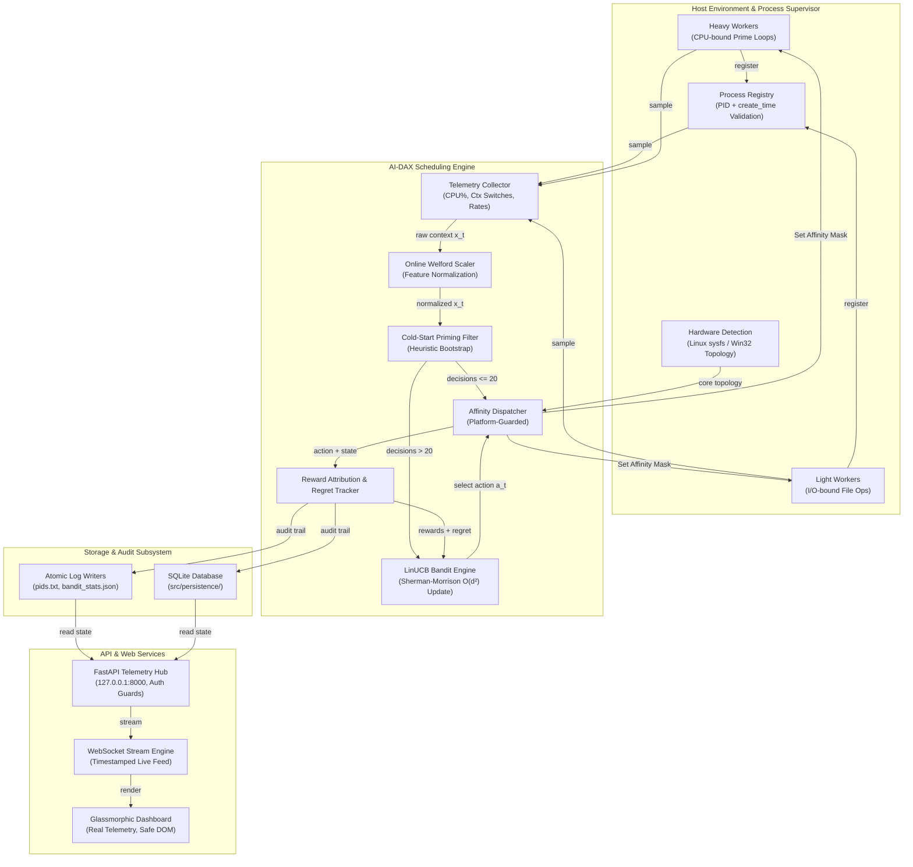

# AI-DAX Lite — System Architecture Specification

## 1. Architectural Philosophy

AI-DAX Lite (*Adaptive Intelligence for Dynamic Allocation and Execution*) is engineered around three foundational systems design principles:

1. **User-Space Principle:** Operates entirely within user space via documented OS interfaces (`sched_setaffinity` on Linux, `SetProcessAffinityMask` on Windows), functioning as an adaptive supervisor rather than a kernel driver.
2. **Partial-Observability Bandit Formulation:** Formalizes thread affinity placement as a contextual multi-armed bandit (LinUCB) that balances exploration of unknown process profiles against exploitation of known core affinity benefits.
3. **Defense-in-Depth & Fail-Safe Operation:** Guarantees that any unexpected termination, hardware failure, or exception immediately triggers emergency affinity restoration to all logical cores, preventing process starvation or lock-in.

---

## 2. High-Level System Architecture

---

## 3. Subsystem Breakdown

### 3.1 Workload Generator (`src/aidax/workload.py` & `src/experiments/`)
- Spawns parameterized mixtures of CPU-intensive (Heavy) and I/O-intensive (Light) worker processes.
- Assigns unique run identifiers and records child process PIDs and start timestamps using atomic JSON writes.
- Manages child process lifecycles and guarantees complete process reaping via `psutil.wait_procs` upon shutdown.

### 3.2 Process Supervisory Management (`src/process/`)
- **ProcessRegistry:** Maintains records of managed processes, storing:
  - Process ID (PID)
  - Process creation timestamp (verified against `psutil.Process.create_time()` to prevent PID-reuse race conditions)
  - Original CPU affinity mask
  - Assigned CPU affinity mask
  - Cumulative scheduling decisions
- **Emergency Recovery:** Automatically restores original affinities upon receiving `SIGINT`/`SIGTERM` or executing `aidax-scheduler --recover`.

### 3.3 Hardware Detection & Topology (`src/hardware/`)
- **Normalized Topology Model:**
  - `total_logical_cores`: Total available hardware execution threads.
  - `total_physical_cores`: Total physical cores.
  - `performance_cores`: List of logical CPU indices classified as Performance Cores (P-cores).
  - `efficiency_cores`: List of logical CPU indices classified as Efficient Cores (E-cores).
  - `is_heterogeneous`: Boolean flag indicating whether distinct microarchitectures are physically present.
  - `is_simulated`: Boolean flag indicating whether homogeneous hardware was partitioned synthetically.

### 3.4 LinUCB Contextual Bandit Engine (`src/aidax/scheduler.py` & `src/scheduler/`)
- **Context Vector ($d = 5$):**
  1. $x_1$: CPU utilization percentage $[0, 100]$.
  2. $x_2$: Voluntary context switch rate (switches/second).
  3. $x_3$: Involuntary context switch rate (switches/second).
  4. $x_4$: Elapsed duration since last core migration (seconds).
  5. $x_5$: Current assigned core category (0 for P-core, 1 for E-core).
- **Linear Model:**
  For each arm $a \in \{\text{P-core}, \text{E-core}\}$:
  $$\hat{\theta}_a = A_a^{-1} b_a$$
  Action selection with upper confidence bound ($\alpha$ exploration parameter):
  $$a_t = \arg\max_{a} \left( \hat{\theta}_a^T x_t + \alpha \sqrt{x_t^T A_a^{-1} x_t} \right)$$
- **Sherman-Morrison Rank-1 Inversion Update ($O(d^2)$):**
  $$A_a^{-1} \leftarrow A_a^{-1} - \frac{A_a^{-1} x_t x_t^T A_a^{-1}}{1 + x_t^T A_a^{-1} x_t}$$
  $$b_a \leftarrow b_a + r_t x_t$$

### 3.5 Telemetry & Persistence Layer (`src/telemetry/`, `src/persistence/`)
- In-memory ring buffers maintain rolling historical observations (up to 1,000 points) for dashboard charts.
- SQLite database (`data/aidax.db`) backed by async SQLAlchemy 2.0 persists decision logs, policy weights, and experiment records.
- Atomic writers ensure that CSV and JSON log outputs cannot be corrupted by abrupt power loss or process crashes.

### 3.6 API & Telemetry Pipeline (`src/aidax/api.py`, `src/api/`)
- High-performance asynchronous FastAPI server providing complete RESTful controls and WebSocket broadcasting.
- Standard localhost loopback binding (`127.0.0.1`) with configurable authentication token enforcement (`X-API-Token`).
- Heartbeat ping-pong monitoring and exponential backoff reconnection on the real-time telemetry stream.
