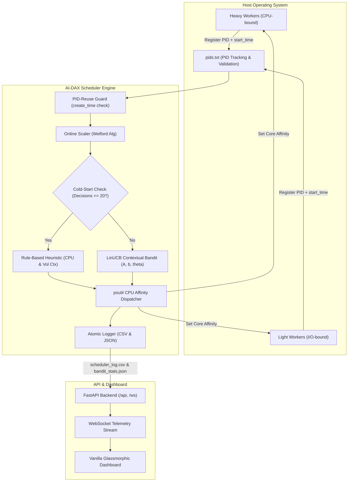

# AI-DAX Lite Architecture

AI-DAX (Adaptive Intelligence for Dynamic Allocation & eXecution) is an adaptive CPU scheduling simulator operating in user-space via contextual multi-armed bandits.

## High-Level Architecture

---

## Component Details

### 1. Workload Generator (`aidax.workload`)
- Spawns distinct processes representing heterogeneous workload demands:
  - **Heavy Workers**: CPU-bound tasks computing primes to simulate compute-intensive threads.
  - **Light Workers**: I/O-bound tasks performing repetitive small disk I/O and sleep intervals.
- Supports both **infinite mode** (for continuous live dashboard demonstrations) and **finite mode** (deterministic primes up to $N$ and I/O cycles for reproducible benchmark runs).
- Safely writes PID, classification type, and process `create_time()` to `pids.txt`.

### 2. Contextual Bandit Scheduler (`aidax.scheduler`)
- Implements the **LinUCB** algorithm (Li et al., WWW 2010) with disjoint linear models per arm.
- **Arm 0**: Route target process to Performance (P) Cores.
- **Arm 1**: Route target process to Efficient (E) Cores.
- **Context Vector ($d=5$)**:
  $$\mathbf{x} = \begin{bmatrix} \text{CPU \%} \\ \text{Voluntary Context Switch Rate} \\ \text{Involuntary Context Switch Rate} \\ \text{Time Since Last Migration} \\ \text{Current Core Affinity Ratio} \end{bmatrix}$$
- **Online Normalisation**: Features are scaled incrementally using **Welford's online algorithm**, standardizing streams to zero-mean and unit-variance without caching entire datasets.
- **Cold-Start Fallback**: For the initial 20 decisions per process, routing follows a rule-based heuristic:
  $$\text{Heavy if } (\text{CPU} > 20\% \text{ and } \text{VolCtxRate} < 500) \text{ else Light}$$
- **Measured Reward**:
  $$R_t = -(\alpha \cdot \text{norm\_invol\_ctx} + \beta \cdot \text{energy\_proxy})$$
  where $\alpha = 0.7$, $\beta = 0.3$, and energy proxy weights reflect physical power scaling ($1.0$ for P-cores, $0.3$ for E-cores).

### 3. Safety & Robustness Mechanisms
- **PID-Reuse Guard**: Verifies `psutil.Process(pid).create_time()` and `username()` before modifying CPU affinity to guarantee no foreign or recycled OS process is modified.
- **Atomic File Operations**: Metrics and bandit parameters are written to unique temporary files (`mkstemp`) and swapped into place using POSIX/Windows `os.replace` to prevent race conditions during reads.
- **Emergency Affinity Reset**: Signal handlers (`SIGINT`, `SIGTERM`) and REST `/api/reset` restore all affinities across all cores to avoid core starvation.

### 4. Telemetry Backend & Frontend (`aidax.api`, `static/`)
- FastAPI ASGI server exposing REST endpoints for live decisions, historical time series, and bandit internals.
- Real-time WebSocket `/ws/live` pushing per-second telemetry to the client.
- Responsive HTML5/CSS3 glassmorphic dashboard visualizing active process distribution, core loads, and cumulative regret convergence.
