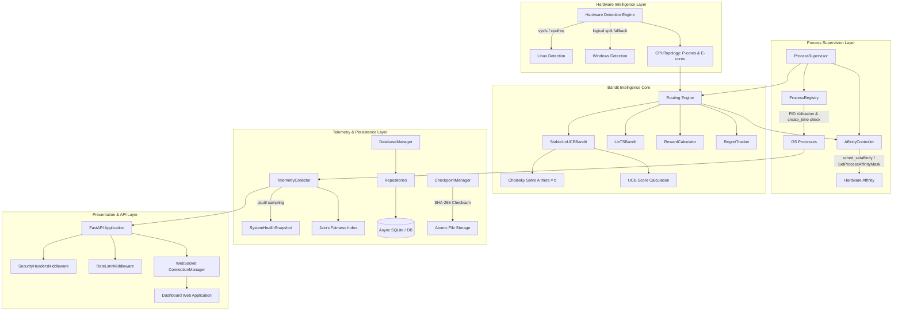

# AI-DAX System Architecture

## 1. Executive Summary

**AI-DAX** (Adaptive Intelligence for Dynamic Allocation and Execution) is an open-source, research-grade scheduling framework designed to dynamically optimize process placement across heterogeneous multi-core architectures (e.g., Intel Alder Lake / Raptor Lake with Performance and Efficient cores).

The system integrates an online contextual bandit reinforcement learning policy (`LinUCB` with regularized Cholesky decomposition and `LinTS` baseline), a non-invasive process supervisor, an asynchronous SQLite/PostgreSQL persistence engine, and a low-latency telemetry API with real-time WebSocket broadcasting.

---

## 2. Component Architecture

---

## 3. Core Subsystems

### 3.1 Hardware Intelligence & Topology Discovery
- **Linux (`src/hardware/linux.py`):** Probes sysfs `/sys/devices/system/cpu/cpu*/topology/core_type` to natively identify Intel Hybrid Performance (`core_type = 1`) and Efficient (`core_type = 0`) cores. Falls back to max frequency partitioning via `/sys/devices/system/cpu/cpu*/cpufreq/cpuinfo_max_freq`.
- **Windows (`src/hardware/windows.py`):** Employs safe logical core partitioning (`confidence = 0.5`) with explicit logging to prevent misleading hardware claims on non-hybrid workstations.
- **Topology Model (`src/hardware/topology.py`):** Exposes validated `p_cores` and `e_cores` bitmasks.

### 3.2 Contextual Bandit Intelligence Core
- **LinUCB with Cholesky Stability (`src/scheduler/linucb.py`):**
  Instead of explicit matrix inversion $\mathbf{A}^{-1}$, the arm parameters are solved using regularized Cholesky factorization:
  $$\mathbf{A} \boldsymbol{\theta} = \mathbf{b}, \quad \mathbf{A} = \mathbf{L} \mathbf{L}^T$$
  $$\mathbf{s} = \mathbf{x}^T \boldsymbol{\theta} + \alpha \sqrt{\mathbf{x}^T \mathbf{A}^{-1} \mathbf{x}}$$
  Ridge regularization ($\mathbf{A} = \lambda \mathbf{I} + \sum \mathbf{x}_t \mathbf{x}_t^T$ with $\lambda = 1.0$) guarantees positive-definiteness and avoids singular matrix crashes.
- **Contextual Thompson Sampling (`src/scheduler/thompson_sampling.py`):**
  Serves as a Bayesian baseline sampling parameter weights from the posterior distribution $\mathcal{N}(\boldsymbol{\mu}, v^2 \mathbf{A}^{-1})$.
- **Multi-Objective Reward Decomposition (`src/scheduler/reward.py`):**
  Explicitly separates context switch penalties, energy proxies, and latency penalties:
  $$R_t = -\left(\alpha \cdot \widetilde{\text{CtxSw}}_t + \beta \cdot \text{EnergyCost}_t + \gamma \cdot \text{Latency}_t + \text{MigrationPenalty}\right)$$

### 3.3 Safe Process Supervision & Affinity Lifecycle
- **Process Registry (`src/process/registry.py`):** Validates PID ownership and verifies `create_time` within 0.5s to completely prevent PID reuse race conditions.
- **Affinity Controller (`src/process/affinity.py`):** Stores original CPU affinities at process registration time and guarantees restoration upon worker termination or emergency reset.
- **Process Supervisor (`src/process/supervisor.py`):** Manages child worker processes, graceful termination, and cleanup handlers.

### 3.4 Cryptographically Verified Persistence
- **SQLAlchemy 2.0 Async (`src/persistence/`):** Full ORM mapping for experiments, individual decisions, system telemetry, and audit logs.
- **Checkpoint Security (`src/persistence/checkpoints.py`):** Checkpoints are written atomically via temporary files and rename (`os.replace`) accompanied by SHA-256 payload checksums to prevent state corruption and model tampering.

### 3.5 API & Real-Time Dashboard
- **FastAPI Backend (`src/api/`):** Bound to `127.0.0.1` by default. Protected by `SecurityHeadersMiddleware` (strict CSP, HSTS, X-Frame-Options) and `RateLimitMiddleware`.
- **WebSocket Streaming (`src/api/websocket/`):** Non-blocking broadcast of structured system telemetry and scheduling decisions.
- **Frontend Dashboard (`static/`):** Hardened against XSS via explicit HTML escaping; consumes dynamic origins to prevent mixed-content or CORS failures.
