# AI-DAX Threat Model & Security Analysis

## 1. Scope & Objective

This document formalizes the defensive security boundaries, threat vectors, and mitigations implemented in AI-DAX according to the **STRIDE** methodology, OWASP Top 10, CWE Top 25, and the NIST Secure Software Development Framework (SSDF).

The system controls low-level operating system CPU affinities and hosts a telemetry dashboard. A compromised scheduling daemon could result in process starvation, denial-of-service, or unauthorized manipulation of system workloads.

---

## 2. Security Boundaries & Trust Zones

```mermaid
flowchart LR
    subgraph Untrusted Network
        CLIENT[Web Browser / External Client]
    end

    subgraph API Security Perimeter
        REV_PROXY[Ingress / Reverse Proxy]
        SEC_MW[Security Headers & Rate Limiting]
        AUTH[Token Authentication & Constant-Time Validation]
    end

    subgraph Application Core
        SCHED[Scheduler Intelligence Engine]
        REG[Process Registry]
    end

    subgraph Kernel / OS Boundary
        OS[OS Process Management & Affinity APIs]
    end

    CLIENT -->|HTTPS / WSS| REV_PROXY
    REV_PROXY --> SEC_MW
    SEC_MW --> AUTH
    AUTH --> SCHED
    SCHED --> REG
    REG -->|Verified PIDs Only| OS
```

---

## 3. STRIDE Threat Analysis & Mitigations

| Threat Category | Threat Description | Severity | Implemented Mitigation | Verification Test |
| :--- | :--- | :--- | :--- | :--- |
| **Spoofing** | Attacker impersonates an administrator to trigger process resets or manipulate allocations. | **High** | Constant-time API token comparison (`hmac.compare_digest`) via `X-API-Token` header. Default binding to `127.0.0.1`. | `test_api_scheduler_reset_auth` |
| **Tampering** | Malicious alteration of `bandit_stats.json` or model checkpoint files to inject NaN or corrupt weights. | **High** | Cryptographic SHA-256 payload checksums verified prior to deserialization; atomic writes via temporary files and `os.replace`. | `test_checkpoint_tamper_detection` |
| **Repudiation** | Unauthorized affinity adjustments or resets occur without accountability. | **Medium** | Append-only `AuditRepository` recording timestamp, actor, action, source IP, and target resources. | `test_database_repositories_in_memory` |
| **Information Disclosure** | Sensitive OS usernames, process paths, or host environment details leak via log outputs or telemetry. | **Medium** | CWE-117 log sanitization (`SanitizedFormatter`) stripping CRLF bytes; exclusion of host paths from telemetry schemas; strict `.gitignore`. | `test_telemetry_live_endpoint` |
| **Denial of Service** | Volumetric flooding of API or WebSocket endpoints starving scheduling cycles. | **High** | In-memory sliding-window `RateLimitMiddleware` (max 300 requests/min per IP); WebSocket connection capping and non-blocking background workers. | `test_security_headers_present` |
| **Elevation of Privilege** | Confused deputy attack: attacker injects arbitrary system PIDs into `pids.txt` to alter affinity of critical OS daemons. | **Critical** | `ProcessRegistry` verifies process owner matches current runner and `create_time` matches within 0.5s before affinity application. Original affinities are tracked and restored. | `test_pid_reuse_guard` |

---

## 4. Specific Vulnerability Mitigations

### 4.1 PID Reuse & Race Conditions (CWE-362 / CWE-377)
In Unix and Windows systems, process IDs are cycled rapidly. If a managed process terminates and the operating system recycles its PID to a root daemon or critical database, modifying affinity based purely on PID integer would compromise host stability.
- **Defense:** At process registration, AI-DAX queries `psutil.Process(pid).create_time()`. Every subsequent affinity modification and telemetry poll re-verifies `create_time`. If the delta exceeds 0.5s, the PID is immediately purged from management.

### 4.2 Log Injection / CRLF Attack (CWE-117)
Attackers can inject newline characters (`\r\n`) into process names or user query strings to forge fake log entries or bypass SIEM parsing.
- **Defense:** AI-DAX implements `SanitizedFormatter` in `src/core/logging.py`, stripping carriage returns and newlines from all format parameters before writing to disk or stderr.

### 4.3 Stored & DOM Cross-Site Scripting (CWE-79)
Local processes can execute with arbitrary names containing `<script>` or `` vectors. When telemetry tables display process names in the web browser, this can result in script execution in the dashboard context.
- **Defense:** `static/app.js` executes strict `escapeHTML()` sanitization over all interpolated variables (`pid`, `workload_type`, `action`, `decision_source`). In addition, `SecurityHeadersMiddleware` deploys a strict Content Security Policy (`script-src 'self'`).

### 4.4 Insecure Deserialization & Model Poisoning (CWE-502)
Loading pickle or unvalidated JSON into LinUCB could cause arbitrary code execution or numerical corruption (NaN weights causing all future actions to produce zero score).
- **Defense:** Serialization uses pure JSON envelopes containing SHA-256 digests. Matrix dimensions, values, and finite numerical validity (`np.all(np.isfinite(...))`) are enforced before model restoration.
